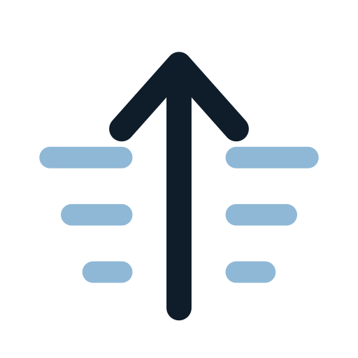

  <picture>
    <source media="(prefers-color-scheme: dark)" srcset="assets/brand/mark-dark.svg">
    
  </picture>

<h1 align="center">Boreasward · 溯风</h1>

<em>Against the wind, northward.</em>

<a href="README_zh.md">中文</a>

---

## The name

**Boreas** is the Greek god of the north wind. The wind comes from the north, carrying cold and noise. **-ward** means *toward*, as in *northward* or *homeward*. Not arrived. Still going.

**Boreasward** is walking toward the north wind. Every step is upwind. You only learn why the wind blows by walking to where it begins.

The Chinese name **溯风** (sù fēng) carries the same idea. 溯 means to go upstream, against the current, and also to trace something back to its source. 溯风 is walking into the wind, back to where it comes from. Tracing to the source is also what research is.

## Lines

| | |
|---|---|
| Primary | **Against the wind, northward.** |
| About page | The wind comes from the north. We walk north. |
| Research | Upwind, to see where it all comes from. |
| Podcast | Where the wind begins. |

## The mark

An arrow pointing north, passing through oncoming wind. The arrow is *-ward*. The wind lines on either side get shorter as they near the arrow: the wind is being split and pushed aside.

| File | Use |
|---|---|
| [`mark-light.svg`](assets/brand/mark-light.svg) | Standard mark on light backgrounds |
| [`mark-dark.svg`](assets/brand/mark-dark.svg) | Standard mark on dark backgrounds |
| [`mark-mono.svg`](assets/brand/mark-mono.svg) | Single color, follows `currentColor`; for inline HTML, watermarks, stamps |
| [`avatar-dark.svg`](assets/brand/avatar-dark.svg) | Avatars, favicons, podcast cover base (dark, heavier strokes, two wind lines) |
| [`avatar-light.svg`](assets/brand/avatar-light.svg) | Same, light |
| [`lockup-light.svg`](assets/brand/lockup-light.svg) | Horizontal lockup: mark + 溯风 + BOREASWARD, light |
| [`lockup-dark.svg`](assets/brand/lockup-dark.svg) | Horizontal lockup, dark |

Rules

- Below 48px, use the avatar versions, never the standard mark.
- Clear space around the mark is at least one quarter of the shaft length.
- No rotation, no stretching, no shadows, no gradients.
- The lockups rely on locally installed fonts. Convert text to outlines before print or upload.

## Color

| Name | Hex | Where |
|---|---|---|
| Polar night | `#0f1c2a` | Primary text, the arrow, dark backgrounds |
| Ice | `#f2f5f8` | Light backgrounds |
| Glacier | `#8fb8d6` (`#9cc4e0` on dark) | Wind lines, emphasis, links |
| Low sun | `#d79a5a` | Only for the thing we are heading toward: key numbers, primary actions. Use sparingly |
| Slate | `#4a5a6b` | Captions, the Latin subtitle |

## Type

- Chinese: a Song/serif face (Noto Serif SC) for the name and headings; a sans (Noto Sans SC) for body text.
- Latin: Jost (fallback Avenir Next), wide tracking, all caps for the subtitle.
- The contrast between the two is the voice of the brand: classical judgement, modern tools.

## What lives here

| Layer | Name | Mark |
|---|---|---|
| Organization | Boreasward · 溯风 | Standard mark |
| Writing | 溯风 | Standard mark |
| Podcast | [去风开始的地方 · Where the Wind Begins](https://github.com/boreasward/podcast) | Dark avatar as cover base |
| Research workbench | To be named | A separate "B" wordmark, to come |

---

© 2026 Boreasward

